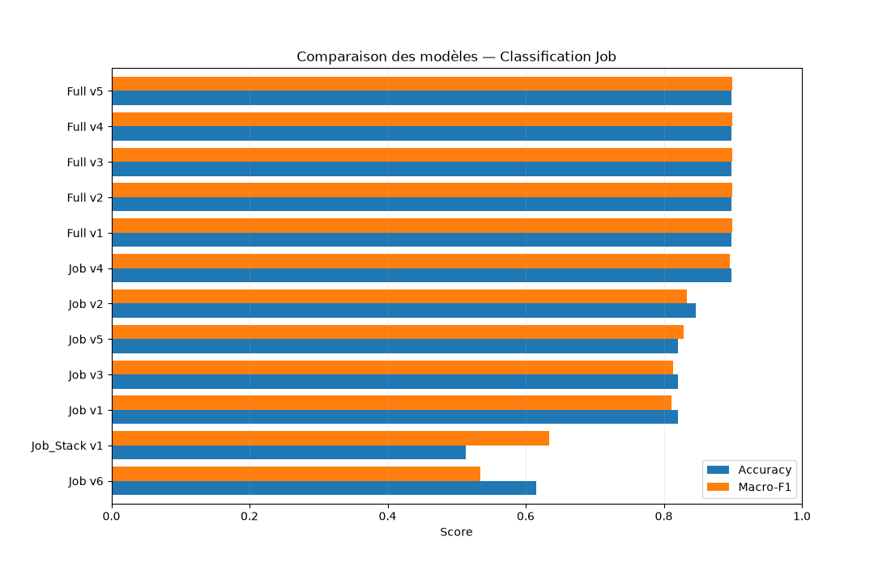
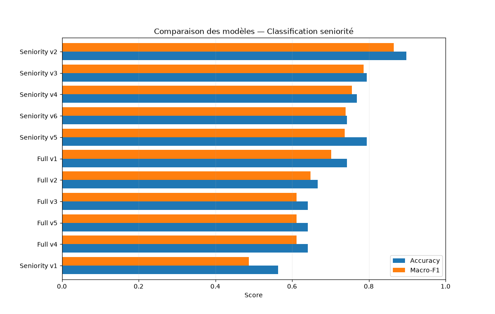
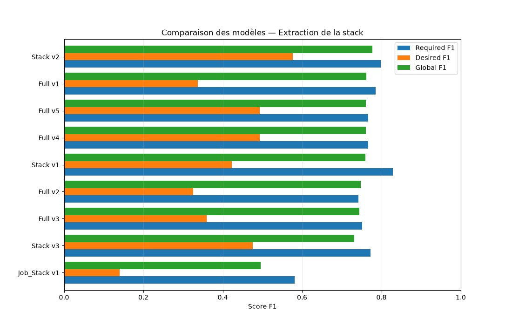

# Job Market Intelligence

**Analyse du marché de l'emploi Data & IA à partir d'offres collectées sur plusieurs plateformes, enrichies par des modèles de langage locaux.**

Ce projet vise à analyser les tendances du marché de l'emploi dans les domaines de la **Data et de l'Intelligence Artificielle**, à partir d'offres d'emploi collectées en avril 2026.

L'objectif est d'identifier les métiers les plus recherchés, les niveaux d'expérience demandés les technologies les plus présentes dans les offres et de me positionner par rapport à ce marché.

## 1. Architecture générale

Le projet s'articule autour de plusieurs étapes :

1. **Collecte et Stockage** des offres d'emploi par web scraping et stockage des données brutes dans MongoDB Atlas.
2. **Nettoyage et préparation** des informations collectées.
3. **Extraction et classification** des informations à l'aide d'un LLM local.
4. **Évaluation** des erreurs et **optimisation** des prompts d'extraction et de classification.
5. **Normalisation** des données produite par le LLM.
6. **Ingéstion** dans Azure SQL et **Structuration** star schema avec fact table pour leur exploitation analytique
7. **Analyse et visualisation** des tendances du marché de l'emploi.

*Figure à ajouter : diagramme d'architecture du pipeline, du scraping jusqu'à Power BI.*

## 2. Collecte des données

### 2.1. Web scraping

La collecte repose sur un **scraper développé sur mesure**, inspiré de l'architecture et des méthodes mises en œuvre lors de mon stage de fin d'études.

Les données proviennent de cinq plateformes :

- LinkedIn
- Indeed
- France Travail
- Station F
- HelloWork

Au total, **2 472 offres d'emploi** ont été collectées et consolidées dans le jeu de données brut.

Les principales informations récupérées sont les suivantes :

| Champ | Description |
|---|---|
| `entreprise` | Nom de l'entreprise qui recrute |
| `poste` | Intitulé de l'offre |
| `description` | Description complète du poste |
| `location` | Localisation géographique |
| `date` | Période de collecte |
| `date_de_publication` | Date de publication indiquée par la plateforme |
| `experience` | Expérience et profil recherchés |
| `nb_candidats` | Nombre de candidats, lorsque disponible |
| `profil_recherche` | Informations complémentaires sur le profil attendu |
| `url` | URL de l'offre |

### 2.2. Stockage dans MongoDB Atlas

Les données collectées sont directement exportées vers **MongoDB Atlas**, qui constitue la couche de stockage des données brutes.

Pour éviter les doublons au sein d'une même période de collecte, un identifiant unique est généré à partir de l'URL de l'annonce et de sa date de scraping.

Cette stratégie permet :

- D'éviter les doublons pour une même offre sur une période donnée.
- De conserver une même annonce lorsqu'elle est observée à différentes périodes.
- De suivre l'évolution du marché de l'emploi dans le temps.

Ce dernier point est important : une annonce présente plusieurs mois consécutifs constitue plusieurs observations historiques, et non nécessairement plusieurs offres distinctes.

*Figure à ajouter : exemple de document MongoDB et illustration du principe d'identification par période.*

## 3. Nettoyage et préparation des données

Les données provenant de plusieurs sources présentent des structures hétérogènes, des informations manquantes et des champs dont le contenu varie selon les plateformes.

Plusieurs opérations de préparation ont donc été réalisées avant leur analyse.

### 3.1. Sélection des colonnes pertinentes

Certaines informations générées par les scrapers ne sont pas nécessaires à l'analyse et ont été retirées du jeu de données analytique.

La colonne `date_de_publication` a également été abandonnée. En effet, les plateformes fournissent souvent des dates relatives, telles que « il y a 3 jours » ou « il y a 1 mois », dont la normalisation implique un traitement supplémentaire.

Pour cette analyse, **le mois de scraping est utilisé comme référence temporelle**. Il permet d'étudier les offres observées à un moment donné, plutôt que leur date exacte de publication.

Cette distinction signifie que les résultats représentent les offres observées durant la période étudiée, et non exclusivement les annonces nouvellement publiées.

### 3.2. Harmonisation des informations

Les colonnes `experience` et `profil_recherche` ont été fusionnées, car elles contiennent des informations complémentaires sur les qualifications et les caractéristiques recherchées chez les candidats.

La colonne `date` a été normalisée au format `YYYY-MM`, afin de faciliter les regroupements mensuels.

### 3.3. Gestion des données manquantes

Les offres ne contenant ni description du poste ni information sur le profil recherché ont été écartées.

En effet, en l'absence de ces deux informations, il devient difficile d'inférer correctement les missions, le niveau d'expérience et les compétences techniques attendues.

À l'inverse, une offre disposant d'une description mais d'aucune information explicite sur l'expérience peut être conservée.

## 4. Extraction et classification des informations (À revoir)

Bien que les données collectées soient désormais exploitables, plusieurs informations essentielles à l'analyse ne sont pas toujours exprimées explicitement.

C'est notamment le cas :

- De la catégorie du métier : Data Scientist, Data Engineer, Data Analyst, etc.
- Du niveau de séniorité : Junior, Intermédiaire, Senior, etc.
- Des technologies et outils requis ou souhaités.

Ces informations doivent être déduites à partir du titre, de la description du poste et des exigences du recruteur.

### 4.1. Première approche : extraction par expressions régulières

Une première méthode déterministe, basée sur des **expressions régulières (regex)**, a été développée.

Elle consiste à rechercher certains mots-clés dans les offres afin de classifier les métiers et les niveaux d'expérience.

Par exemple, la présence de « Data Engineer » dans le titre peut indiquer la catégorie du poste, tandis que les termes « senior » ou « stagiaire » peuvent fournir des indications sur le niveau recherché.

Cette approche présente l'avantage d'être simple, rapide et peu coûteuse.

Cependant, elle montre rapidement ses limites :

- **Absence de compréhension contextuelle :** le mot « stagiaire » peut désigner une personne que le futur salarié devra encadrer, sans que le poste proposé soit un stage.
- **Ambiguïté des intitulés :** certains métiers possèdent des titres génériques ne reflétant pas précisément les missions.
- **Difficulté à interpréter les informations implicites :** le niveau d'expérience attendu peut être décrit sans mention explicite de « junior » ou « senior ».

Ces limites ont motivé l'exploration d'une approche fondée sur les modèles de langage.

### 4.2. Seconde approche : inférence par LLM local

Pour améliorer la qualité des extractions, une solution basée sur un **Large Language Model (LLM)** a été mise en place.

Afin de maîtriser les coûts d'inférence sur plusieurs milliers d'offres, le choix s'est porté sur une exécution locale plutôt que sur l'utilisation systématique d'API commerciales.

Le modèle retenu est **Qwen3 14B**, exécuté via **Ollama** sur une machine équipée d'un GPU AMD Radeon RX 6900 XT.

L'utilisation du LLM permet d'analyser conjointement :

- Le titre de l'offre (`poste`).
- La description complète (`description`).
- Les informations relatives à l'expérience (`experience`).

Chaque tâche dispose d'instructions adaptées, comprenant des définitions, des règles de décision et des exemples.

Les sorties sont contraintes par des **schémas JSON**, afin de garantir une structure cohérente et d'automatiser le traitement des résultats.

*Figure à ajouter : exemple d'une offre anonymisée en entrée et d'une réponse JSON structurée produite par le LLM.*

### 4.3. Classification des catégories de métiers

La première tâche consiste à attribuer à chaque offre une catégorie professionnelle à partir des missions décrites.

Contrairement à l'approche par regex, le LLM ne se limite pas à la présence de mots-clés dans l'intitulé du poste.

Il s'appuie également sur des définitions des différentes familles de métiers pour identifier la catégorie la plus adaptée.

Cette méthode vise notamment à mieux distinguer les postes aux intitulés proches, mais dont les responsabilités diffèrent.

### 4.4. Classification de la séniorité

La seconde tâche porte sur l'identification du niveau de séniorité attendu.

Quatre catégories sont utilisées :

| Catégorie | Niveau d'expérience de référence |
|---|---|
| Stage / Alternance | Contrat de formation |
| Junior | 0 à 2 ans |
| Intermédiaire | 2 à 5 ans |
| Senior | 5 ans et plus |

La classification ne repose pas uniquement sur les années d'expérience mentionnées dans l'offre.

Le modèle prend également en compte l'intitulé du poste, les responsabilités, l'autonomie attendue et la nature des missions afin de déterminer le niveau le plus cohérent.

### 4.5. Extraction des technologies

La troisième tâche consiste à identifier les technologies mentionnées dans les annonces.

Les éléments extraits comprennent notamment les langages de programmation, frameworks, bibliothèques, services cloud, bases de données et outils de développement.

L'extraction distingue deux catégories :

- **`stack_required` :** technologies explicitement requises.
- **`stack_desired` :** technologies souhaitées ou considérées comme des atouts.

Une étape supplémentaire de normalisation est réalisée pour regrouper les différentes variantes d'une même technologie.

Par exemple, `PowerBI`, `Power BI` et `power bi` sont regroupés sous le nom `Power BI`.

Un dictionnaire d'alias permet d'harmoniser les appellations, tandis qu'une liste d'exclusions filtre les concepts génériques qui ne correspondent pas à des technologies précises.

Ce traitement facilite notamment le calcul de la fréquence d'apparition des différentes technologies dans les offres.

4.6. Fusion des tâches au sein d'un même prompt

Afin de réduire le temps d'inférence et d'optimiser les performances, j'ai sélectionné les prompts les plus performants sur le jeu de validation et regroupé leurs instructions au sein d'un prompt unique, évitant ainsi de soumettre plusieurs fois une même offre au LLM.

Les schémas de sortie JSON ont également été fusionnés afin de permettre l'extraction simultanée des différentes informations dans une seule réponse structurée.

## 5. Évaluation et optimisation des modèles (À revoir)

La fiabilité des classifications est essentielle, car les résultats alimentent directement les futures analyses du marché de l'emploi.

Une méthodologie d'évaluation progressive a donc été mise en place.

### 5.1. Analyse exploratoire des erreurs

Dans un premier temps, les résultats produits par le LLM ont été comparés à ceux de l'approche par expressions régulières.

Cette comparaison a porté sur **200 offres d'emploi**.

Les désaccords ont ensuite été examinés manuellement afin de comprendre les décisions des deux méthodes.

L'analyse a mis en évidence plusieurs cas où le LLM fournissait une classification plus cohérente avec le contexte de l'offre que l'approche par mots-clés.

Les erreurs observées ont permis d'améliorer progressivement les prompts, notamment par l'ajout de règles et d'exemples supplémentaires.

Cette première phase constituait un diagnostic qualitatif. Les prédictions produites par regex ne représentaient pas une vérité terrain suffisamment fiable pour mesurer seules les performances du modèle.

### 5.2. Constitution d'un jeu de référence

Pour réaliser une évaluation plus rigoureuse, **80 offres ont été sélectionnées aléatoirement**, puis réparties en jeux de validation et de test.

Ces offres ont été pré-annotées à l'aide de modèles de langage plus puissants, notamment ChatGPT et Claude, avant d'être revues manuellement.

Cette démarche permet de construire une référence de classification plus fiable que les seules prédictions issues de règles déterministes, tout en réduisant le volume d'annotation manuelle initial.

### 5.3. Évaluation quantitative

Les différentes versions des prompts ont été évaluées sur les jeux de validation et de test.

Pour les tâches de classification, la métrique principale retenue est le **F1-score**, qui combine la précision et le rappel.

Les résultats ont servi à comparer les différentes stratégies d'inférence et à sélectionner les configurations les plus performantes pour chaque tâche.

Les prompts retenus ont ensuite été utilisés pour enrichir le jeu de données final.

  

  <em>Figure 1 — F1-scores des prompts sur le jeu de test pour la classification des métiers</em>

  

  <em>Figure 2 — F1-scores des prompts sur le jeu de test pour la classification de la séniorité</em>

  

  <em>Figure 3 — F1-scores des prompts sur le jeu de test pour l'extraction des technologies</em>

### 5.4. Inférence sur les données

Les résultats sur le jeu de test ont montré que les prompts réalisant l'ensemble des tâches d'extraction en un seul passage n'obtenaient pas systématiquement les meilleures performances.

J'ai néanmoins choisi de conserver le prompt Full v5 pour deux tâches :

 - Classification des métiers : Full v5 est le prompt ayant obtenu les meilleures performances.

 - Extraction des technologies : ses performances sont très proches de celles du meilleur prompt spécialisé, avec un F1-score global de 0,76 contre 0,78, en considérant à la fois les technologies requises et souhaitées.

Pour la classification de la séniorité, j'ai retenu le prompt spécialisé Seniority v2, qui a obtenu les meilleurs résultats lors de l'évaluation.

La stratégie finale repose donc sur deux appels au modèle par offre, afin de conserver de bonnes performances tout en optimisant le coût de calcul.

## 6. Structuration des données et analyse (À faire)

Les informations extraites par les LLM et normalisées sont destinées à être intégrées dans une base relationnelle **Azure SQL**, afin de faciliter leur exploitation dans **Power BI**.

Le modèle analytique envisagé repose sur trois ensembles principaux :

- Une table d'offres contenant les informations générales, les catégories de métiers et les niveaux d'expérience.
- Un référentiel des technologies normalisées.
- Une table de liaison associant chaque observation d'offre aux technologies requises ou souhaitées.

Cette organisation permettra d'explorer plusieurs dimensions du marché de l'emploi :

- Répartition des offres par catégorie de métier.
- Répartition des niveaux de séniorité.
- Technologies les plus fréquemment demandées.
- Technologies recherchées selon les métiers.
- Différences entre les technologies requises et souhaitées.
- Répartition géographique des offres.
- Évolution mensuelle des observations lors de futures collectes.

*Figure à ajouter : schéma relationnel SQL, puis captures du dashboard Power BI une fois réalisé.*

## 7. Assistant RAG de candidature (À faire)

Le second volet du projet vise à construire un assistant personnel utilisant une architecture **Retrieval-Augmented Generation (RAG)**.

Contrairement à la partie consacrée à l'analyse du marché, cet assistant sera alimenté par des informations personnelles : expériences professionnelles, projets, compétences et parcours académique.

Son objectif sera de retrouver les éléments de parcours les plus pertinents pour :

- Personnaliser un CV en fonction d'une offre.
- Préparer une lettre de motivation.
- Formuler des réponses aux questions des recruteurs.
- Illustrer des compétences à partir d'expériences et de projets concrets.

L'architecture et les résultats de cette partie seront documentés au fur et à mesure de son développement.

## 8. Stack technique

| Domaine | Technologies |
|---|---|
| Langage et traitement des données | Python, pandas |
| Collecte des données | Web scraping Playwright |
| Stockage des données brutes | MongoDB Atlas |
| LLM local | Qwen3 14B, Ollama |
| Évaluation | scikit-learn, F1-score |
| Base analytique cible | Azure SQL |
| Visualisation cible | Power BI |

## 9. Limites et perspectives

Plusieurs limites doivent être prises en compte dans l'interprétation des résultats.

**Représentativité des données.** Les offres proviennent d'une sélection de plateformes et ne constituent pas un recensement exhaustif du marché de l'emploi Data & IA.

**Référence temporelle.** L'analyse repose sur le mois de collecte et non sur la date réelle de publication des annonces.

**Fiabilité des extractions.** Malgré l'évaluation des prompts, les informations inférées par le LLM peuvent comporter des erreurs, notamment lorsque les descriptions sont ambiguës ou incomplètes.

**Taille du jeu d'évaluation.** Le jeu annoté reste relativement limité et ses résultats ne garantissent pas les mêmes performances sur l'ensemble des offres collectées.

Les prochaines étapes consistent à finaliser la modélisation analytique, construire le dashboard Power BI et développer le volet RAG.
