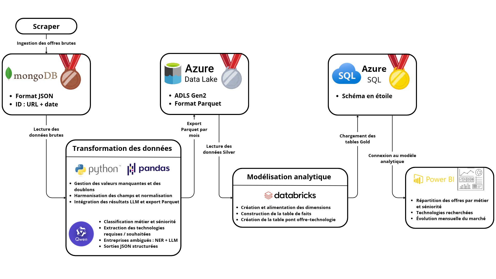

# Job Market Intelligence

**Analyse du marché de l'emploi Data & IA en France.**

Ce projet personnel consiste à développer un pipeline Data de bout en bout pour collecter, nettoyer, classifier et analyser des offres d'emploi.

L'objectif est de transformer des données non structurées en informations exploitables dans **Power BI**, afin d'étudier les métiers, les niveaux d'expérience et les compétences techniques recherchées par les entreprises.

## Architecture

Le projet repose sur une **architecture médaillon** (Bronze, Silver, Gold) :

1. **Collecte des données :** extraction des offres depuis différentes plateformes à l'aide de scrapers Python.
2. **MongoDB Atlas — Bronze :** ingestion et stockage des offres brutes.
3. **Transformation — Python & LLM local :** nettoyage, normalisation et extraction d'informations structurées avec Qwen3 14B.
4. **Azure Data Lake Storage Gen2 — Silver :** stockage des données nettoyées et enrichies au format Parquet.
5. **Databricks SQL — Silver → Gold :** transformation des données Silver, création et alimentation des tables du modèle dimensionnel.
6. **Azure SQL — Gold :** stockage du Data Warehouse en schéma étoile — *en cours*.
7. **Power BI :** visualisation des tendances du marché de l'emploi Data & IA — *en cours*.

Les choix de stockage, l'organisation des couches et le modèle dimensionnel sont détaillés dans la [documentation d'architecture](docs/architecture.md).

## Préparation et enrichissement des données

Les offres sont collectées sur **LinkedIn, Indeed, France Travail, Station F et HelloWork**, puis chargées depuis MongoDB pour être préparées avec Pandas.

Le traitement comprend l'harmonisation des champs, la gestion des informations manquantes et la déduplication. Le LLM identifie ensuite le métier, la séniorité et les technologies requises ou souhaitées. Les résultats sont normalisés avant leur export vers la couche Silver.

Les règles de nettoyage, les prompts utilisés et le traitement des sorties sont présentés dans [Transformation des données](docs/data_transformation.md).

## Résultats

- **2 472 offres** collectées sur cinq plateformes.
- **1 970 offres** conservées après nettoyage et déduplication.
- **Data Warehouse :** construction d'un modèle en étoile avec dimensions, table de faits et table de liaison des technologies — *en cours*.

### Évaluation du LLM

Plusieurs versions de prompts utilisant **Qwen3 14B** ont été comparées sur des offres annotées manuellement.

Les configurations retenues dans le pipeline sont **Full v5** pour le métier et les technologies, et **Seniority v2** pour la séniorité.

| Tâche | Configuration | Résultat sur le jeu de test |
|---|---|---:|
| Classification du métier | `Full v5` | Macro-F1 : **89,9 %** |
| Classification de la séniorité | `Seniority v2` | Macro-F1 : **86,5 %** |
| Extraction des technologies | `Full v5` | F1 micro global : **76,1 %** |
| Normalisation des entreprises | `Company v1` | Accuracy : **100 %** sur 35 noms renseignés |

Les trois premières tâches sont évaluées sur **39 offres de test**. Ces résultats restent à interpréter au regard de la taille des échantillons.

La constitution des jeux de validation et de test, les métriques, les graphiques et les compromis de sélection sont détaillés dans [Évaluation des prompts du LLM](docs/llm_evaluation.md).

## Stack technique

| Domaine | Technologies |
|---|---|
| Extraction | Python, Playwright |
| Stockage | MongoDB Atlas, Azure Data Lake Storage Gen2 |
| Traitement | Pandas, SQL, Databricks |
| IA générative | Ollama, Qwen3 14B |
| Normalisation des entreprises | spaCy, expressions régulières, LLM |
| Data Warehouse | Databricks SQL, Azure SQL |
| Visualisation | Power BI |

## Documentation technique

| Document | Contenu |
|---|---|
| [Transformation des données](docs/data_transformation.md) | Chargement depuis MongoDB, nettoyage, inférence et normalisation des résultats |
| [Évaluation du LLM](docs/llm_evaluation.md) | Jeux annotés, comparaison des prompts, métriques et analyse des résultats |
| [Architecture et modèle dimensionnel](docs/architecture.md) | Couches Bronze, Silver et Gold, schéma étoile et relations entre les tables |

### Accès au code

- [Pipeline principal](pipeline.py) : orchestration du chargement, de l'enrichissement et de l'export.
- [Chargement et stockage](src/load/) : échanges avec MongoDB et Azure Data Lake.
- [Transformations](src/transformation/) : nettoyage, inférence et évaluation.
- [Configuration des prompts](src/transformation/instructions_llm.json) : instructions, versions et schémas de sortie.
- [Modélisation du Data Warehouse](warehouse/) : scripts SQL de création et d'alimentation des tables.

---

*Projet personnel en cours de développement.*