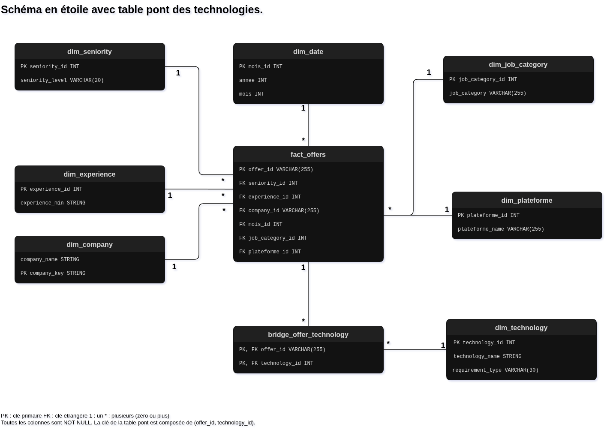

# Architecture et modélisation analytique

Le projet organise les données selon une **architecture médaillon** :

| Couche | Stockage | Contenu |
|---|---|---|
| Bronze | MongoDB Atlas | Offres brutes collectées |
| Silver | Azure Data Lake Storage Gen2 | Offres nettoyées, enrichies et normalisées au format Parquet |
| Gold | Azure SQL — en cours | Modèle dimensionnel destiné à l'analyse |

**Databricks SQL** est utilisé pour construire les transformations analytiques et les tables du modèle Gold. **Power BI** constitue l'outil de visualisation cible.

La préparation de la couche Silver est décrite dans [Transformation des données](data_transformation.md).

## 1. Schéma du modèle

Le modèle comprend une table de faits centrale, des dimensions et une table de pont des technologies.

Le schéma doit refléter le choix suivant : **`requirement_type` appartient à la table de pont, et non à `dim_technology`.**

## 2. Pourquoi un schéma étoile ?

Le schéma étoile sépare les observations des informations permettant de les décrire.

La table de faits représente les offres. Les dimensions fournissent les axes d'analyse : métier, entreprise, période, plateforme, séniorité et expérience.

Cette organisation facilite :

- La centralisation des catégories et de leurs libellés.
- Les regroupements et les filtres dans SQL et Power BI.
- Le croisement de plusieurs axes, comme les technologies demandées pour les postes juniors de Data Engineer.

## 3. Table de faits : `fact_offers`

### Granularité

Chaque ligne représente une observation d'offre conservée après préparation, identifiée par `offer_id`.

La table contient les clés de ses dimensions :

| Colonne | Dimension associée |
|---|---|
| `job_category_id` | Métier |
| `seniority_id` | Séniorité |
| `experience_id` | Expérience minimale demandée |
| `company_id` | Entreprise, via `company_key` |
| `mois_id` | Mois de collecte |
| `plateforme_id` | Plateforme d'origine |

Cette table ne contient pas de mesure numérique comme un prix. **La présence d'une ligne constitue le fait à compter.**

Pour un suivi mensuel, la granularité cible sera une observation d'annonce par mois. Cela nécessite d'aligner l'identification et la déduplication sur cette règle.

### Analyses possibles

La table de faits permet de calculer :

- Le nombre d'offres par métier, entreprise ou plateforme.
- La répartition des offres par séniorité.
- L'expérience minimale demandée pour chaque niveau.
- L'évolution des volumes observés par mois.

Le mois correspond à la collecte, et non à la publication.

## 4. Dimensions

| Table | Contenu | Exemple d'analyse |
|---|---|---|
| `dim_job_category` | Catégories de métiers | Comparer Data Analyst et Data Engineer |
| `dim_seniority` | Niveaux de séniorité | Mesurer la part d'offres juniors |
| `dim_experience` | Catégories d'expérience minimale | Étudier les années demandées aux juniors |
| `dim_company` | Noms et clés normalisés des entreprises | Compter les offres par entreprise |
| `dim_date` | Année et mois de collecte | Suivre les volumes mensuels |
| `dim_plateforme` | Plateformes d'origine | Comparer les sources |
| `dim_technology` | Technologies normalisées | Identifier les outils les plus demandés |

### Séniorité et expérience

Ces dimensions décrivent deux informations différentes.

Une offre classée « Junior » peut demander zéro, un ou deux ans d'expérience. Leur séparation permet de répondre à la question :

**Parmi les offres juniors, combien demandent déjà deux ans d'expérience ?**

## 5. Table de pont des technologies

### Pourquoi une table supplémentaire ?

Une offre peut demander plusieurs technologies, et une technologie peut apparaître dans plusieurs offres : il s'agit d'une relation **plusieurs-à-plusieurs**.

`bridge_offer_technology` associe chaque offre à ses technologies :

| offer_id | technology_id | requirement_type |
|---|---:|---|
| Offre A | 1 | required |
| Offre A | 2 | desired |
| Offre B | 1 | desired |

Si `1` correspond à Python et `2` à SQL :

- L'offre A exige Python et souhaite SQL.
- L'offre B souhaite Python.

**La table de pont est la liste des technologies associées à chaque offre, avec leur caractère requis ou souhaité.** Elle ne crée pas un identifiant par combinaison de technologies.

### Requis ou souhaité

`dim_technology` contient une seule entrée par technologie. Python conserve donc le même identifiant dans toutes les offres.

`requirement_type` appartient à la table de pont, car il décrit la relation entre une offre et une technologie :

- `required` : technologie requise.
- `desired` : technologie souhaitée.

La clé composée `(offer_id, technology_id, requirement_type)` évite les associations identiques tout en permettant de conserver une technologie dans les deux catégories pour une même offre.

### Comptage par technologie

Après la jointure, une offre peut apparaître sur plusieurs lignes. `COUNT(DISTINCT f.offer_id)` évite de la compter plusieurs fois pour une même technologie.

Un filtre sur `requirement_type` distingue les technologies requises des souhaitées.

Les volumes par technologie ne sont pas additionnables pour retrouver le total des offres : une offre peut mentionner plusieurs outils.

## 6. Construction avec Databricks SQL

| Script | Rôle |
|---|---|
| [`01_create_dim.sql`](../warehouse/ddl/01_create_dim.sql) | Création des dimensions |
| [`02_create_fact.sql`](../warehouse/ddl/02_create_fact.sql) | Création de la table de faits |
| [`03_create_bridge_offer_technology.sql`](../warehouse/ddl/03_create_bridge_offer_technology.sql) | Création de la table de pont |

Les scripts et le schéma doivent être alignés sur le placement de `requirement_type` dans la table de pont.

L'alimentation suit les dépendances :

1. Extraire les valeurs distinctes de Silver pour alimenter les dimensions.
2. Associer les offres aux clés de dimensions et alimenter `fact_offers`.
3. Décomposer les listes de technologies pour alimenter la table de pont, en conservant leur type d'exigence.

Les scripts d'alimentation sont regroupés dans [`warehouse/dml/`](../warehouse/dml/).

### Contrôles de cohérence

Les chargements doivent vérifier :

- L'unicité des observations dans la table de faits.
- L'unicité des clés de dimensions.
- L'absence d'associations identiques dans la table de pont.
- L'absence de références à des lignes inexistantes.
- La cohérence des volumes entre Silver et Gold.

## 7. Automatisation prévue

Le fonctionnement cible couvre toute la chaîne :

1. **Collecte planifiée** : exécution automatique des scrapers.
2. **Ingestion Bronze** : insertion des observations dans MongoDB.
3. **Transformation** : nettoyage, enrichissement avec Ollama et normalisation.
4. **Publication Silver** : export Parquet dans Azure Data Lake.
5. **Alimentation Gold** : exécution des transformations SQL et chargement du Data Warehouse.
6. **Actualisation Power BI** : déclenchement de l'actualisation du modèle sémantique après validation du chargement Gold.

Chaque étape dépend du succès de la précédente. Une erreur de chargement doit empêcher la publication de données incomplètes dans Power BI.

L'orchestration devra prévoir :

- Des journaux d'exécution et des alertes.
- Une reprise des étapes en échec.
- Des chargements idempotents : une relance ne doit pas créer de doublons.
- La disponibilité de la machine exécutant les scrapers et Ollama.
- Une gestion des accès aux services utilisés.

L'outil d'orchestration et le mécanisme d'actualisation Power BI restent à sélectionner et à configurer.

**Statut : automatisation prévue, non encore implémentée.**