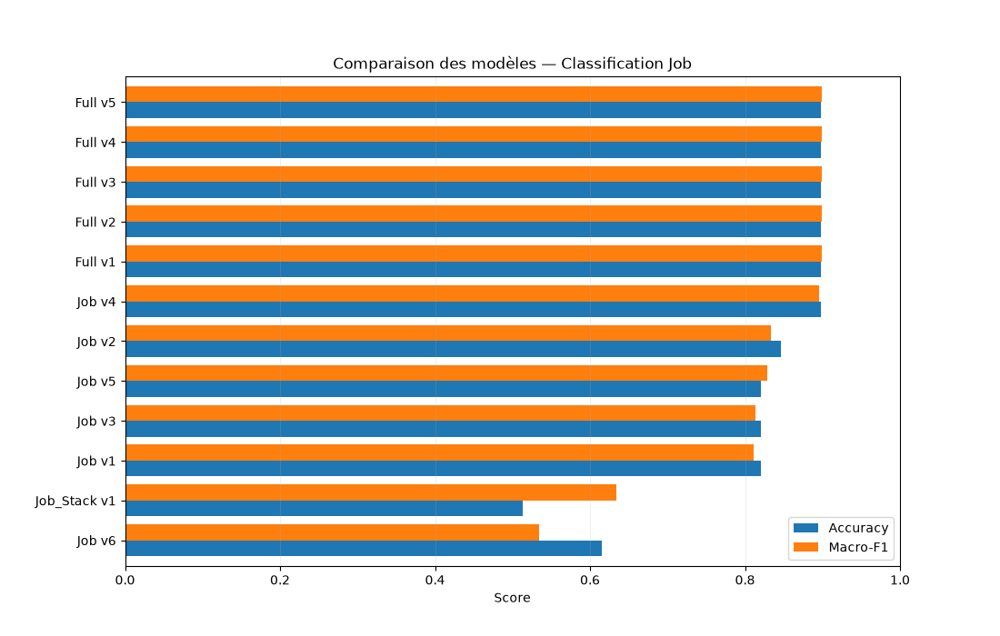
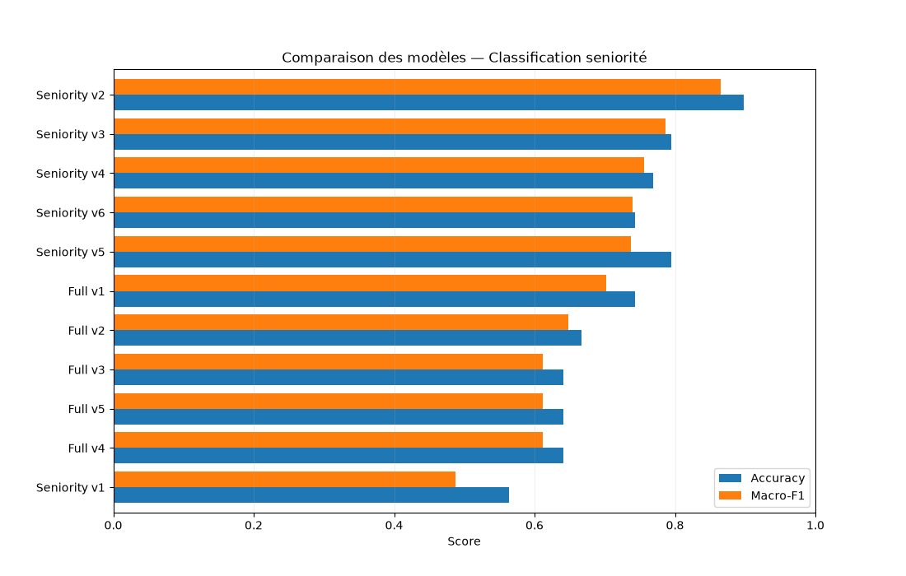
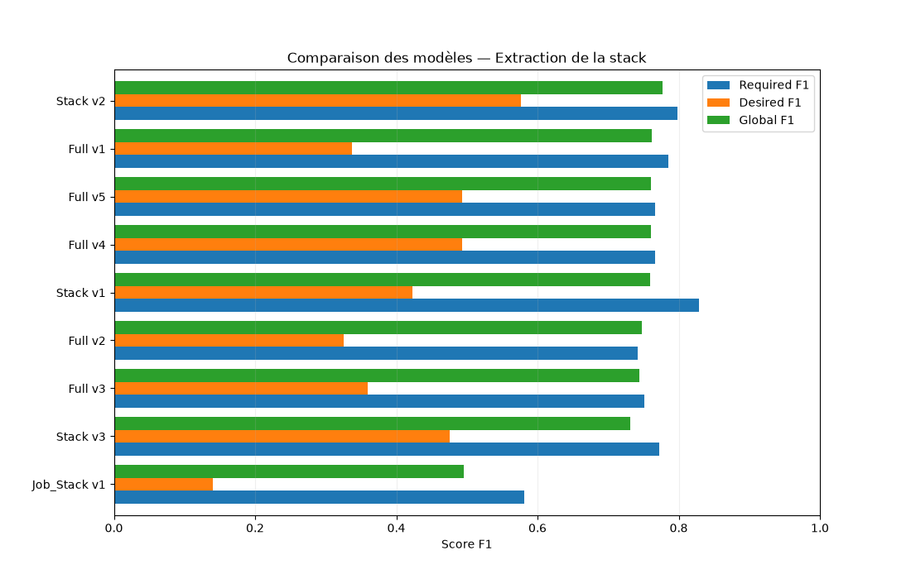

# Évaluation des prompts du LLM

L'évaluation compare plusieurs versions de prompts utilisant **Qwen3 14B** pour la classification du métier, la classification de la séniorité et l'extraction des technologies.

Le modèle n'est pas réentraîné : les expérimentations portent sur les instructions et les stratégies d'extraction, spécialisées ou combinées.

## 1. Diagnostic initial

Une première analyse a comparé les classifications produites par regex et par le LLM sur **200 offres**.

Les désaccords ont été examinés manuellement pour identifier les limites des règles et les erreurs d'interprétation du modèle. Cette analyse a servi à préciser les consignes et à ajouter des exemples aux prompts.

Cette étape constituait un diagnostic qualitatif : les prédictions regex n'étaient pas considérées comme une vérité terrain.

## 2. Constitution des jeux annotés

Les offres de référence ont été préannotées avec des modèles de langage, notamment ChatGPT et Claude, puis revues et corrigées manuellement.

Les fichiers actuels contiennent :

| Jeu | Taille | Fichier | Rôle |
|---|---:|---|---|
| Validation | 42 offres | [`data_val.xlsx`](../src/transformation/data_llm/data_val.xlsx) | Comparaison des versions et analyse des erreurs |
| Test | 39 offres | [`data_test.xlsx`](../src/transformation/data_llm/data_test.xlsx) | Comparaison sur un jeu distinct |

Les annotations comprennent le métier, la séniorité et les technologies requises ou souhaitées. Les fichiers comportent également une référence pour la normalisation des entreprises.

Les colonnes d'annotation sont retirées des données envoyées au LLM afin de ne pas lui fournir les réponses attendues.

## 3. Méthode et métriques

La classe `LLMExtractor`, dans [`src/transformation/llm.py`](../src/transformation/llm.py), centralise l'évaluation :

- `evaluate_prompt()` compare les prédictions aux annotations.
- `evaluate_prompt_versions()` exécute plusieurs versions et sauvegarde leurs résultats.

| Tâche | Métriques |
|---|---|
| Métier et séniorité | Accuracy, macro-F1 et nombre d'erreurs |
| Technologies | Précision, rappel et F1 micro pour les technologies requises, souhaitées et leur union |
| Entreprises | Accuracy par correspondance exacte après harmonisation de la casse et des espaces périphériques |

Le macro-F1 donne le même poids à chaque classe évaluée. Pour les technologies, la précision mesure la justesse des éléments extraits et le rappel leur couverture.

Les technologies annotées et prédites sont normalisées avec `to_set()` et `clean_stack()` avant comparaison. Les éléments manquants et ceux extraits en trop sont conservés pour analyser les erreurs.

## 4. Résultats sur le jeu de test

### Classification du métier

Les configurations `Full v1` à `Full v5` obtiennent les mêmes résultats :

- **Accuracy : 89,7 %**
- **Macro-F1 : 0,899**
- **4 erreurs sur 39 offres**

`Full v5` est retenu parmi ces configurations pour produire conjointement le métier, les technologies et les informations d'expérience.

### Classification de la séniorité

`Seniority v2` obtient les meilleurs résultats sur ce jeu :

- **Accuracy : 89,7 %**
- **Macro-F1 : 0,865**
- **4 erreurs sur 39 offres**

La séniorité est donc traitée par un prompt dédié dans la configuration retenue.

### Extraction des technologies

| Configuration | F1 requises | F1 souhaitées | F1 global |
|---|---:|---:|---:|
| `Stack v2` | 0,799 | 0,577 | 0,777 |
| `Full v5` | 0,766 | 0,494 | 0,761 |

`Stack v2` obtient de meilleurs résultats. `Full v5` est néanmoins retenu comme compromis entre qualité d'extraction et nombre de requêtes.

La distinction entre technologies requises et souhaitées reste plus difficile que l'identification de leur présence dans une offre.

### Normalisation des entreprises

`Company v1` obtient :

| Jeu | Noms évalués | Accuracy |
|---|---:|---:|
| Validation | 40 | 97,5 % |
| Test | 35 | 100 % |

Les offres sans nom d'entreprise sont exclues de cette évaluation.

Ces scores évaluent le prompt de normalisation sur les noms renseignés. Ils ne mesurent pas, à eux seuls, la qualité du filtre NER utilisé pour sélectionner les noms à transmettre au LLM dans le pipeline.

## 5. Configuration retenue

`extract_best_models()`, dans [`pipeline.py`](../pipeline.py), combine :

- **`Full v5`** pour le métier, les technologies et les informations d'expérience.
- **`Seniority v2`** pour le niveau de séniorité final.

Cette stratégie réalise **deux appels au modèle par offre**.

La normalisation des entreprises est effectuée séparément, uniquement sur les noms distincts sélectionnés par le filtre décrit dans [Transformation des données](data_transformation.md).

## 6. Traçabilité

Les résultats sont enregistrés dans [`evaluation_llm/`](../src/transformation/evaluation_llm/) :

- `val/` : résultats de validation.
- `test/` : résultats de test.
- `assets/` : graphiques.

Les fichiers CSV contiennent les métriques par version. Les fichiers Parquet conservent les prédictions, les annotations et les informations utiles à l'analyse des erreurs.

L'évaluation des prompts appartient à la phase d'expérimentation. Elle n'a pas vocation à être réexécutée à chaque collecte.

## 7. Limites méthodologiques

Les jeux évalués sont de petite taille : sur 39 offres, une seule erreur représente environ **2,6 points d'accuracy**.

La préannotation par d'autres LLM peut également introduire des biais, même après revue manuelle.

Le classement varie selon le jeu : `Seniority v4` obtient un macro-F1 de **0,863 en validation**, contre **0,704 pour v2**, alors que `v2` arrive en tête sur le test.

Si les résultats de test servent à sélectionner ou modifier les prompts, ce jeu participe au développement. Un nouvel échantillon indépendant est alors nécessaire pour mesurer la performance finale sans biais de sélection.

Enfin, les scores décrivent les offres évaluées et ne garantissent pas les mêmes performances sur d'autres périodes, plateformes ou zones géographiques.